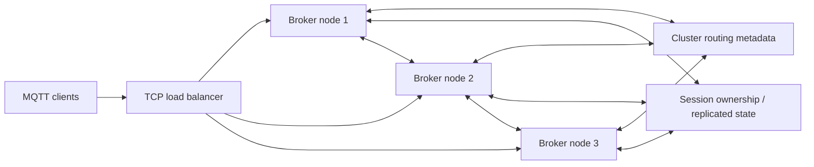

# MQTT broker 集群：从单进程到分布式

本文面向已经理解 Kafka、分区和副本的读者，解释 MQTT 与分布式系统的关系，
以及把单机 broker 扩展成集群时需要解决的问题。它是架构教学材料，不表示 Sol
已经支持集群。

## MQTT 是为分布式服务的吗？

是，但要区分两个层次：**MQTT 是面向网络应用的客户端—服务器发布/订阅协议；
它并不要求 MQTT Server 自身由多个节点组成。** 设备、服务和用户程序可以分布
在不同机器上，通过 broker 解耦通信；broker 则可以是一个进程，也可以是集群。

MQTT 3.1.1 规定客户端如何连接服务器、发布和订阅、匹配主题、维护会话，以及
QoS 报文交换。规范描述了一个逻辑 Server 的外部行为，没有规定节点发现、状态
复制、分片、选主或故障切换。规范也允许一个 Server 同时作为 MQTT Client 和
Server 连接其它 Server；这给桥接留出协议空间，但不等于定义了透明集群或一致性
模型。[MQTT 3.1.1 规范](https://docs.oasis-open.org/mqtt/mqtt/v3.1.1/os/mqtt-v3.1.1-os.html)

所以，“MQTT 用于分布式应用”是对的；“MQTT broker 天生就是分布式系统”则不对。
单 broker 也能服务大量分布式客户端，只是它仍是单点和单机资源边界。多线程、
多核或 `SO_REUSEPORT` 能提高单机并发，不会自动带来节点故障容忍。

## 与 Kafka 的状态模型对照

| 维度 | Kafka 常见模型 | MQTT broker 常见模型 |
|---|---|---|
| 核心状态 | 分区日志、复制日志、消费位点 | 长连接、会话、订阅、保留消息、QoS 在途状态 |
| 主要定位 | 可回放的持久事件流 | 按主题过滤并向当前订阅者转发消息 |
| 自然分片键 | topic partition | 通常是 `client_id` 的会话所有权；主题路由还需另一套索引 |
| 消费关系 | 消费者主动拉取分区记录 | broker 按订阅主动推送到客户端 |
| 扩展问题 | 分区所有者、日志复制和消费位点 | 客户端连接在哪个节点、会话归谁、发布如何找到各节点订阅者 |

这只是典型职责的对比，不是说 Kafka 没有连接或 MQTT 没有持久化。Sol 的 WAL
保存 retained 消息和持久会话状态，但它不是分区复制日志：当前没有节点间日志
复制、分区领导者或 quorum。

MQTT QoS 1/2 描述客户端与 Server 之间特定一跳的协议状态机。它不等于跨节点、
跨服务的业务事务，也不自动保证应用只处理一次。集群内部转发还要定义持久化、
重试、去重、顺序和故障恢复；即使两段链路都使用 QoS 2，也不能直接推出端到端
业务“恰好一次”。

## 集群究竟要共享什么

TCP 连接始终落在接入它的节点上；节点宕机时连接不能搬到另一台机器，客户端要
重连。其余状态需要明确归属和恢复方式：

- **会话所有权**：以 `client_id` 为稳定键，确定一个时刻由哪个节点处理该客户端。
  会话含订阅、离线队列、出站 QoS 1/2 inflight、入站 QoS 2 去重状态等。
- **订阅和路由索引**：发布到 `plant/room1/temp` 时，节点必须知道哪些节点有匹配
 订阅，再把消息送到这些节点。只广播给所有节点实现简单，但随节点数和消息率放大。
- **保留消息**：新订阅者应读取到当前 retained 值；多节点更新同一主题时需要定义
  顺序、覆盖和故障恢复规则。
- **连接时序状态**：Keep Alive、遗嘱、重复 ClientId 踢旧连接等行为需要唯一所有者。
  例如两个分区都认为自己拥有同一 ClientId，可能导致并行连接、重复遗嘱或消息交错。
- **安全与运维状态**：认证/ACL 配置版本、配额、统计和管理操作要明确是节点本地还是
  集群一致的。

MQTT 3.1.1 持久会话明确包含订阅和未完成/待发送的 QoS 1/2 状态；retained 消息
则不属于某个会话。两类状态有不同生命周期，不能用“把会话存进数据库”一句话
代替设计。[规范 §3.1.2、§4.1](https://docs.oasis-open.org/mqtt/mqtt/v3.1.1/os/mqtt-v3.1.1-os.html)

## 一种可讨论的集群形状

图只是职责示意，不指定数据库或共识算法。负载均衡器只选择初次接入节点，不能
单独解决持久会话归属；重连后任一节点都需要找到会话 owner，或能从副本安全恢复。
实际 broker 集群常把本地订阅表和跨节点路由元数据分开维护；例如 EMQX 文档描述
了节点本地订阅表以及集群路由表/主题树的同步。[EMQX 集群架构](https://docs.emqx.com/en/emqx/latest/develop/cluster/introduction.html)

## 关键取舍

1. **单写者还是多写者**：同一 `client_id` 的会话通常需要单写者，避免 QoS 状态
   与 packet id 并发推进。所有权需要租约或 fencing token，旧 owner 失联后不能继续
   提交写入。
2. **确认时机**：若服务端先向客户端 PUBACK/PUBREC，再异步复制，节点立即宕机时
   已确认状态可能丢失。若等副本确认再应答，可靠性更强，但增加延迟；副本不可用时
   是否停止接收也需定义。
3. **路由方式**：全节点广播容易起步，但成本约随节点数增长；集中路由表易理解，
   却可能成为热点；分层或分片路由更可扩展，复杂度也更高。
4. **分区时可用性**：网络分区中要决定哪个分区保留会话写权限。两边都接收写入会
   产生冲突；只允许 quorum 一侧继续则另一侧可能拒绝连接或暂缓确认。
5. **桥接还是同一集群**：桥接多个独立 broker 可逐步连接不同站点，但通常不会
   自动共享完整会话和订阅状态；还需要防止转发环路、重复消息并明确来源与 ACL。

没有免费的“横向扩容”：复制改善故障恢复但增加写延迟和存储流量；分片降低单节点
负担但引入跨分片路由；本地状态提升速度但故障时需要恢复路径。集群设计首先要写清
可接受的数据丢失、重复、顺序、故障恢复时间和分区行为，再选机制。

## Sol 的边界与演进练习

当前 Sol 是**单 broker 进程、单机状态模型**，进程内可以有多个事件循环线程。连接、
会话、主题索引、WAL 和 retained 状态都在同一 `struct server` 的生命周期内；WAL
用于本机崩溃恢复，不在多个节点之间复制。节点失效后没有自动接管、会话迁移或集群
路由。这里的显式 `struct server *` 上下文让依赖更容易走读，但不是分布式边界。

适合作为教学项目的后续练习顺序：

1. 明确目标：只做多节点吞吐、单节点故障接管，还是两者都要；写下允许的丢失、重复、
   顺序变化和恢复时间。
2. 把会话、保留消息和订阅路由定义成独立存储/路由接口；先在单节点实现并测试重启恢复，
   确认状态转换和确认时机。
3. 为 broker 节点分配稳定身份，以 `client_id` 分片会话并实现所有权租约/隔离令牌；
   加入节点间传输和明确的内部消息标识。
4. 复制会话状态并实现 owner 故障接管，再处理重复 ClientId、旧 owner 恢复、遗嘱只发布
   一次等边界。
5. 设计订阅路由索引和 retained 状态的归属/复制规则；避免把全量广播误当作可扩展路由。
6. 注入节点崩溃、网络分区、延迟、重复内部包和磁盘失败，验证消息顺序、确认后状态、
   去重、遗嘱、ACL 及恢复时间。

每一步都应先有故障语义和测试，再实现机制。若目标只是扩大单机容量，先测量事件循环、
锁竞争、WAL fsync 和内存策略，增加单机线程或优化索引通常更简单；若目标是高可用，
才需要承担多节点状态和一致性设计。
